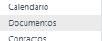
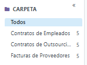
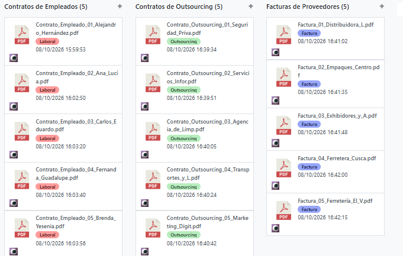
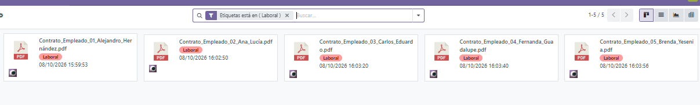
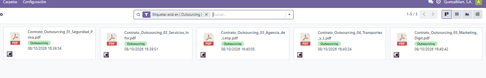
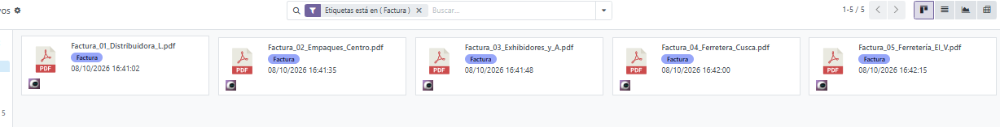

# Manual Detallado de Configuración y Uso: Gestor Documental ERP
**Empresa:** QuetzalMart, S.A.
**Módulo:** Documentos (Odoo)
**Responsable:** Integrante 1 - Responsable del Sistema de Gestión

---

## 1. Configuración Inicial del Entorno Documental

Esta sección detalla los pasos técnicos realizados para preparar el módulo de Documentos, asegurando que la estructura soporte la correcta clasificación de la información de QuetzalMart.

### 1.1. Acceso e Inicialización del Módulo
1. Ingresar al ERP con credenciales de administrador o con permisos de Responsable del Sistema de Gestión.
2. En el panel principal de aplicaciones (Dashboard), localizar y hacer clic en el módulo **Documentos**.
3. Verificar que la vista principal (Kanban o Lista) se cargue correctamente sin errores de acceso.

### 1.2. Creación de la Estructura de Carpetas (Espacios de Trabajo)
Para abandonar el almacenamiento generalizado y pasar a un esquema estructurado, se crearon carpetas dedicadas para cada flujo de la empresa.

**Pasos realizados:**
1. Navegar a **Configuración > Espacios de Trabajo** (o directamente en el panel lateral izquierdo "Carpetas").
2. Hacer clic en el botón **Nuevo / Crear**.
3. Crear el primer espacio: Ingresar el nombre `Contratos de Empleados`. Guardar.
4. Crear el segundo espacio: Ingresar el nombre `Contratos de Outsourcing`. Guardar.
5. Crear el tercer espacio: Ingresar el nombre `Facturas de Proveedores`. Guardar.
6. Refrescar la vista principal para confirmar que el panel izquierdo despliega las tres carpetas correctamente bajo la sección "CARPETA".

### 1.3. Creación y Asignación de Etiquetas (Tags)
Las etiquetas son fundamentales para el filtrado multidimensional. Se configuraron con códigos de color para facilitar la identificación visual rápida.

**Pasos realizados:**
1. Ir a **Configuración > Etiquetas** (o gestionarlas directamente desde los ajustes del Espacio de Trabajo).
2. Crear la etiqueta `Laboral`, asignar el color **Rojo**, y vincularla a la categoría de contratos internos.
3. Crear la etiqueta `Outsourcing`, asignar el color **Verde**, y vincularla a la categoría de servicios de terceros.
4. Crear la etiqueta `Factura`, asignar el color **Azul**, y vincularla a la categoría de proveedores.

---

## 2. Procedimiento Operativo: Carga de Archivos Esenciales

Con el entorno preparado, se procedió a la ingesta de los documentos iniciales requeridos para el arranque del sistema.

### 2.1. Preparación de los Documentos PDF
Se generaron y validaron 15 archivos en formato PDF, cumpliendo con la nomenclatura estándar de la empresa:
* **5 Contratos Laborales** (Ej. *Contrato_Empleado_01_Alejandro_Hernández.pdf*)
* **5 Contratos de Outsourcing** (Ej. *Contrato_Outsourcing_01_Seguridad_Priva.pdf*)
* **5 Facturas de Proveedores** (Ej. *Factura_01_Distribuidora_L.pdf*)

### 2.2. Ejecución de la Carga al ERP
1. En el módulo de Documentos, seleccionar la carpeta destino en el panel izquierdo (ej. `Contratos de Empleados`).
2. Hacer clic en el botón **Subir** ubicado en la barra superior izquierda.
3. En la ventana del explorador de archivos, seleccionar los 5 PDFs correspondientes a esa categoría.
4. Confirmar la subida y esperar a que la barra de progreso de cada archivo finalice y se generen las vistas previas (miniaturas) en el ERP.
5. Repetir los pasos 1 al 4 para las carpetas `Contratos de Outsourcing` y `Facturas de Proveedores`.

---

## 3. Clasificación, Etiquetado y Organización Final

Subir el documento es solo la primera fase; la validación en el ERP requiere que los metadatos (etiquetas) estén correctamente asignados para su posterior recuperación.

**Pasos realizados:**
1. Hacer clic sobre el primer documento subido (ej. *Contrato_Empleado_01_Alejandro_Hernández.pdf*).
2. Al seleccionarlo, se desplegará un panel de detalles en el lado derecho de la pantalla.
3. En el campo **Etiquetas**, desplegar el menú y seleccionar `Laboral`. El sistema guardará el cambio automáticamente y el tag rojo aparecerá bajo el nombre del archivo.
4. Repetir el proceso para los 4 contratos restantes de esa columna.
5. Navegar a los contratos de la segunda columna (Outsourcing) y asignar a todos la etiqueta verde `Outsourcing`.
6. Navegar a las facturas (tercera columna) y asignar a todas la etiqueta azul `Factura`.
7. **Revisión de Calidad:** Visualizar la vista general para confirmar que los 15 archivos tienen su respectiva etiqueta visible en el tablero principal.

## 4. Validación de Funcionamiento: Búsqueda y Filtrado

Para demostrar que el gestor documental no es solo un repositorio estático, sino una herramienta de integración activa, se probó el sistema de filtrado.

**Pasos de validación (Instrucciones para el usuario final):**
1. En la pantalla principal de Documentos, ubicar la **Barra de Búsqueda** superior (donde dice "Buscar...").
2. Posicionar el cursor en la barra y escribir "Outsourcing", seleccionando la opción de filtrar por Etiqueta. Alternativamente, hacer clic directamente en la etiqueta `Outsourcing` en el panel de filtros del lado izquierdo.
3. El sistema procesará la solicitud en tiempo real.
4. **Resultado esperado:** Los contratos de empleados y facturas desaparecerán temporalmente de la vista, mostrando exclusivamente los 5 documentos que contienen la etiqueta `Outsourcing`. Para restaurar la vista, simplemente eliminar el filtro de la barra de búsqueda pulsando la "X".

